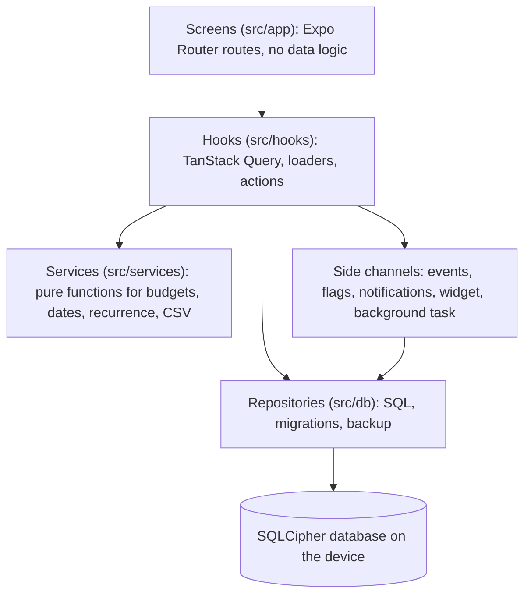

# Nickel

An offline-first budgeting app for iOS and Android. It records spending, tracks budgets and
recurring bills, and reports where money goes. All data stays in an encrypted SQLite database on
the phone; there is no server and no bank connection.

Built with React Native (Expo SDK 57), TypeScript in strict mode, SQLCipher, TanStack Query, Jest
and Maestro.

## Engineering highlights

- 422 automated tests (unit, database and component). Database tests run against a real SQLite
  engine (`node:sqlite`) through the same interface the app uses; seven Maestro flows are set up
  to run on an Android emulator in CI.
- The database is encrypted with SQLCipher using a random 256-bit key held in the Android Keystore
  / iOS Keychain. An optional app lock uses Face ID, fingerprint or the device passcode, and the
  screen is covered in the app switcher.
- CSV import of 10,000 rows: parse and validate in 123 ms, insert as one undoable batch in 197 ms
  (Node 24 on a Ryzen 7 7735HS; device figures pending). Every bad row is reported with its line
  number and does not block the rest of the file.
- Money is stored as integer cents and parsed from strings without floating point; the schema
  rejects non-integer and zero amounts.
- Categorisation learns from the user: merchant rules, suggestions from past filing, and bills
  detected in transaction history, all computed on the device by tested pure functions.
- Receipt text is recognised on the device (Apple Vision, Google ML Kit) and the total, date and
  shop are offered as a suggestion. Foreign purchases are converted with exchange rates from a
  public API that receives only two currency codes and a date; rates are cached for offline use
  and conversion uses integer arithmetic.

## Features

- Quick add from Home: one line such as `12.50 groceries loblaws yesterday` becomes a
  transaction. The line under the field shows how it was read before saving, and an undo bar
  follows.
- Transactions: add, edit, delete; search by note or merchant, filter by category, swipe to delete
  with undo, and an optional receipt photo from the camera or the photo library. In a
  development or release build, the photo's total, date and shop are read on the device and
  offered with "Use these". The list renders
  with FlashList; FlatList can be switched on from the debug screen to compare first-render times
  on a device.
- Category rules ("merchant contains Uber Eats: Eating out"), applied to new, imported and
  quick-add transactions. Changing a transaction's category offers to make a rule and to move
  earlier transactions from the same merchant. Without a rule, the category used most often for
  that merchant is suggested.
- Budgets per category with warnings at 80% and 100%, a "safe to spend today" figure, and one-tap
  copy of last period's limits. Budget periods can start on any day from the 1st to the 28th (for
  example payday). A category can roll over: unspent money carries into the next period and
  overspending comes off it.
- Purchases in about 30 other currencies (`€24 dinner` in quick add, or the currency picker in
  the form), converted to the home currency at that day's rate from
  [Frankfurter](https://frankfurter.dev). Rates are stored, so each is downloaded once; offline,
  the newest stored rate is offered or the rate can be typed.
- Savings goals with a target amount and optional date, the amount needed each month, and whether
  savings are on track. Money set aside for a goal does not count as spending.
- Recurring bills (weekly, monthly, yearly) that create transactions when due, including while the
  app is closed through a background task. A bill on the 31st falls on the last day of shorter
  months and returns to the 31st afterwards. Charges that repeat in past transactions (for
  example a streaming subscription) are suggested as bills.
- Insights: spending by category, a 12-period trend, top merchants and the largest expenses. Tap
  a slice or row to highlight a category and again to see its transactions; tap a bar to move to
  that period.
- A review of each period as a few cards: the total and change, the category that changed most,
  the top merchant, budgets kept, the busiest weekday, the largest expense and money put towards
  goals. Home offers it in the first week of the next period; it can be shared as text.
- CSV import with column mapping, date-format detection, debit and credit columns, comma decimals,
  a preview and a validation report; CSV export that the importer reads back unchanged.
- Full backup and restore as one JSON file, validated row by row and restored in one transaction.
  Receipt photos are not included.
- Local notifications: bill reminders, budget warnings once per threshold per period, and a Sunday
  summary.
- Android home screen widget with today's safe-to-spend amount and an Add button. With the app
  lock on, the widget shows "Locked" instead of amounts.
- Quick actions on the app icon (Add expense, Insights, Bills), `nickel://` deep links, and haptic
  feedback on saves, deletes and selections.
- Amounts and dates follow the device locale (for example `€1.234,56` and `5. Juni`).
- Amounts count to their new value and progress bars slide after a change; loading shows
  placeholder rows. Every animation is skipped when the system's reduce motion setting is on.
- Event log, feature flags with deterministic assignment, an onboarding A/B test, and a debug
  screen with median and p95 timings (long press the version line in Settings).
- Optional crash reporting through Sentry: off by default, and when turned on it sends only the
  error and stack trace.

## Decisions and trade-offs

Data stays on the device because the project's scope excludes accounts, sync and bank access, and
that removes a server, credentials and personal data in transit. Integer cents avoid rounding
error in totals. Expo was chosen because it builds for both platforms without a Mac. Database
access is hand-written SQL behind typed repository functions, so the queries that drive the
indexes are visible and tested directly. The reasoning for each choice is in
[docs/decisions.md](docs/decisions.md).

## How it works



Each layer calls only the one below it. Every write runs inside a SQL transaction, and one shared
connection with a serial queue serves the app, the background task and the widget, so an
unrelated query issued while a transaction is open cannot run inside it. Migrations are numbered,
frozen once released, and tested by upgrading a database that already holds data.

## The onboarding experiment

New installs are split between two first-run flows: A is a three-step setup (categories and a
first budget); B goes straight to Home with a prompt to add a transaction. The metric is the share
of installs that add a first transaction within 24 hours of first opening the app.

Assignment hashes a locally stored install id with the flag key (FNV-1a, 100 buckets), so an
install always sees the same variant without a server, and separate flags are independent. The
first assignment is stored, so a later change of weights does not move existing users. Variants
can be overridden from the debug screen; overridden installs are excluded from the analysis.

To analyse, export events as JSON from the debug screen on each device and run:

```sh
npm run analyze:ab -- exports/*.json
```

The script reports conversion per variant with 95% Wilson intervals and the sample size.

### Limitations

With a handful of devices the intervals are wide and overlap; the result cannot show that one
variant is better. The participants are friends rather than a random sample of users, a device can
be exported more than once (the script keeps one row per install), and an install that is deleted
before export is lost. The experiment demonstrates the method, not a product decision.

## Quick start

Requires Node 24.

```sh
npm ci
npx expo start        # scan the QR code with Expo Go, or press a / i
npm test              # unit, database and component tests
```

Expo Go runs the app without encryption, receipt reading, home screen quick actions, the widget,
background refresh or crash reporting, because those need native code that Expo Go does not
include. A development build has everything: `npx expo run:android`, or
`eas build --profile development`. Release steps and update channels are in
[docs/releasing.md](docs/releasing.md).

Checks on every push: ESLint, Prettier, `tsc --noEmit`, Jest with coverage, and `npm audit` for
production dependencies. Pushes to `main` also build a release APK and run the Maestro flows in
[e2e/](e2e/) on an Android emulator.

## Measurements

| Metric                                   | Value                        | How it is measured                                                        |
| ---------------------------------------- | ---------------------------- | ------------------------------------------------------------------------- |
| Automated tests                          | 422                          | `npm run test:ci`                                                         |
| Statement coverage                       | 72%                          | Jest coverage of `src/` excluding routes; device-only code is not covered |
| JS bundle (Hermes bytecode)              | 6.3 MB Android, 6.1 MB iOS   | `npx expo export`                                                         |
| CSV import, 10,000 rows                  | 123 ms validate, 197 ms save | Node 24, Ryzen 7 7735HS, in-memory SQLite                                 |
| Insights queries, 10,000 rows            | 5 ms median                  | Same machine, 20 runs                                                     |
| Cold start (JS start to Home data)       | not yet measured on device   | `timing` event `cold_start`, median over 20 launches on the debug screen  |
| Insights load on device                  | not yet measured             | `timing` event `insights_load` after adding 10,000 demo rows from Debug   |
| List first render, FlashList vs FlatList | not yet measured             | `timing` event `list_first_render` with each engine, 10,000 rows          |
| Onboarding A/B result                    | not yet collected            | `npm run analyze:ab`                                                      |

## Out of scope

Bank connections, payments, user accounts, cloud sync, multiple devices, shared budgets and social
features.

## Documentation

- [docs/decisions.md](docs/decisions.md): choices and the reasons for them
- [docs/releasing.md](docs/releasing.md): builds, update channels and rollback
- [docs/accessibility.md](docs/accessibility.md): what is implemented and the device checklist
- [SECURITY.md](SECURITY.md): data protection and reporting a vulnerability
- [e2e/](e2e/): Maestro flows

## Licence

MIT. See [LICENSE](LICENSE).
