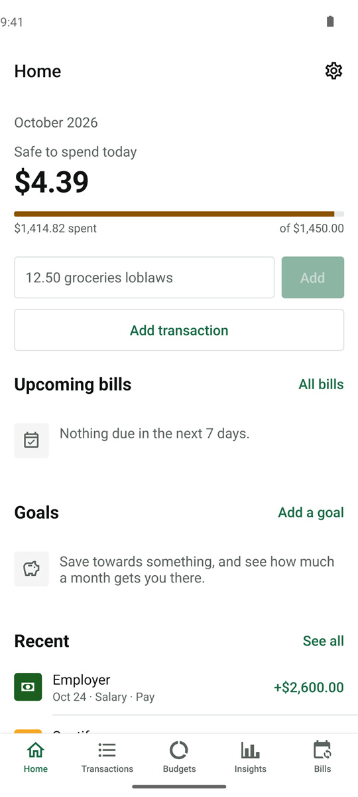
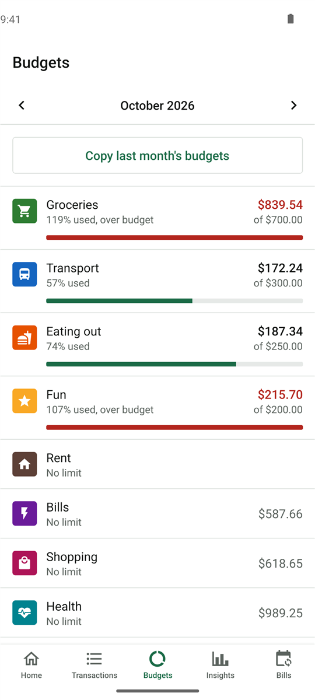
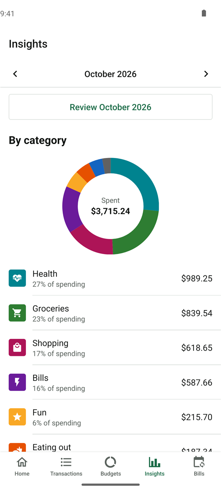
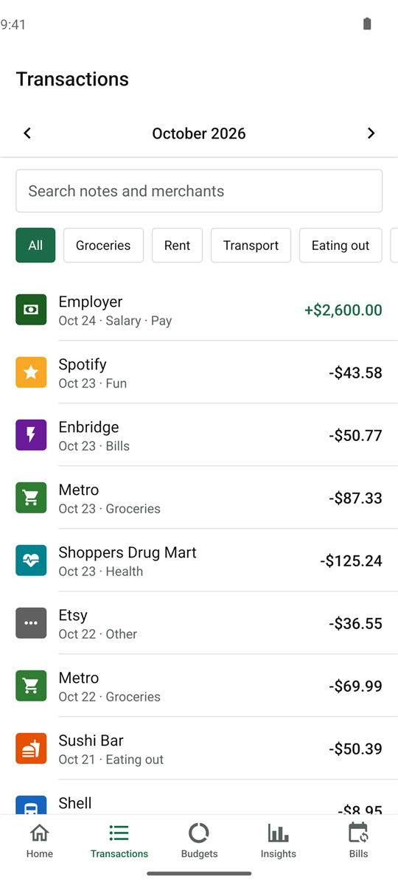

# Nickel

A budgeting app for Android and iOS that keeps everything on the phone. No account, no bank
login, no server. You type in what you spent (or import a CSV from your bank), set budgets per
category, and it tells you how much you can still spend today.

Built with Expo (SDK 57), React Native, TypeScript and SQLite.

<p>
  
  
  
  
</p>

Screenshots are taken on an Android emulator in CI with generated demo data
(`e2e/screenshots/screenshots.yaml`).

## What it does

- Add a transaction from one line on the home screen, e.g. `12.50 groceries loblaws yesterday`.
  The line underneath shows how it was understood before you save.
- Budgets per category, with a warning at 80% and 100%. The budget month can start on any day
  (payday, for example), and unspent money can roll over into the next one.
- Recurring bills that get added automatically when they're due. It also looks through past
  transactions and suggests bills it finds, like a monthly streaming charge.
- Category rules such as "merchant contains Uber Eats → Eating out". When you recategorise
  something, it offers to make a rule for next time.
- Savings goals with a target date and how much you need to put away per month.
- Spending in other currencies: `€24 dinner` is converted at that day's rate from
  [Frankfurter](https://frankfurter.dev). Rates are cached so it still works offline.
- Receipt photos. In a full build (not Expo Go) the total, date and shop are read on the device
  and offered as a suggestion.
- Charts of spending by category and over the last 12 months, plus a short review at the end of
  each month.
- CSV import and export, and a full JSON backup you can restore on another phone.
- An Android home screen widget, bill reminders and an optional Face ID / fingerprint lock.

## Running it

You need Node 24.

```sh
npm ci
npx expo start
```

Scan the QR code with Expo Go. Expo Go can't load some native modules, so a few things are off
there: database encryption, receipt reading, the widget, background refresh and crash reporting.
For everything, make a development build with `npx expo run:android`.

```sh
npm test            # Jest: unit, database and component tests
npm run lint
npm run typecheck
```

## How the code is organised

```
src/
  app/          screens (Expo Router)
  components/   UI pieces: forms, lists, charts
  hooks/        TanStack Query hooks and the actions screens call
  services/     pure logic: money parsing, periods, recurrence, CSV, bill detection
  db/           migrations and SQL repositories
  platform/     thin wrappers around native modules
```

Screens don't talk to the database directly. They go through hooks, which call the repositories
and the pure functions in `services/`. Most of the logic lives in `services/`, so it can be
tested without a phone.

A few things I paid attention to:

- Money is stored as integer cents and parsed from the text the user typed, never through
  `parseFloat`. The schema rejects anything that isn't an integer.
- The database is encrypted with SQLCipher. The key is random and lives in the Android Keystore
  or iOS Keychain.
- Database tests run against a real SQLite engine (`node:sqlite`) through the same interface the
  app uses, so the actual SQL gets tested, not a mock.
- All writes go through one queue. expo-sqlite transactions aren't exclusive, and without the
  queue an unrelated write could end up inside someone else's transaction. There's a test that
  reproduces it.
- Migrations are numbered and never edited after release, and each one is tested by upgrading a
  database that already has data in it.

The longer reasoning behind these choices is in [docs/decisions.md](docs/decisions.md).

## Tests and CI

There are 422 Jest tests, with 72% statement coverage of `src/` (screens excluded). GitHub
Actions runs lint, Prettier, `tsc` and the tests on every push, plus a dependency audit. Pushes to
`main` also build an APK and run the [Maestro](https://maestro.mobile.dev) flows in `e2e/` on an
Android emulator.

Some numbers from my machine (Node 24, Ryzen 7 7735HS, in-memory SQLite):

| What                       | Time                                         |
| -------------------------- | -------------------------------------------- |
| Import 10,000 CSV rows     | 123 ms to parse and validate, 197 ms to save |
| Insights queries, 10k rows | 5 ms median over 20 runs                     |

I haven't measured startup time or list rendering on a real device yet.

## Experiment tooling

The app has the plumbing for A/B tests without a server: feature flags, event logging and an
analysis script. Variants are assigned from a hash of the install id and the flag key, so an
install always gets the same variant and separate experiments don't affect each other. Events go
to a local table and can be exported as JSON from the debug screen, and
`npm run analyze:ab -- exports/*.json` reports conversion per variant with 95% confidence
intervals.

The first flag splits onboarding between a three-step setup and going straight to the home
screen, measured by whether a first transaction is added within 24 hours. It hasn't been run with
real users, so there's no result to report.

## Not included

Bank syncing, accounts, cloud sync and shared budgets are deliberately left out. The iOS widget
isn't done because it needs a paid Apple developer account.

## Other docs

- [docs/decisions.md](docs/decisions.md): why things are built the way they are
- [docs/releasing.md](docs/releasing.md): builds and over-the-air updates
- [docs/accessibility.md](docs/accessibility.md): screen reader support and what's left to test
- [SECURITY.md](SECURITY.md): how data is protected, and reporting issues

MIT licence.
